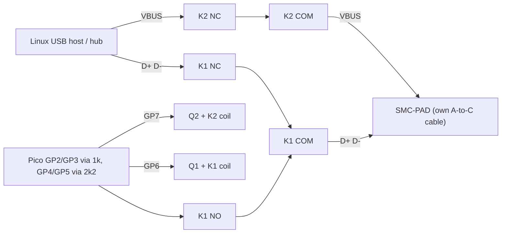

# USB_KEY recovery dongle (Raspberry Pi Pico) for the SMC-PAD (JieLi AC636N / BR25)

This dongle puts the SMC-PAD into the chip's **mask-ROM USB bootloader** ("UBOOT1.00").
In that mode, [jl-uboot-tool](https://github.com/kagaimiq/jl-uboot-tool) can read and
write the whole SPI flash, so the pad can be recovered even if its firmware is broken.
The full procedure, Linux USB host requirements, and flash dump comparison are in
[docs/recovery.md](../../docs/recovery.md).

> [!IMPORTANT]
> Status: **tested on paper only.** The firmware has passed a cycle-accurate model
> ([host/pio_model.py](host/pio_model.py)), but nothing has been built or connected
> to the pad yet. Run the bench test plan below, with a logic analyzer, before the
> pad goes anywhere near the dongle.

## How it works (one paragraph)
The ROM listens for a 16-bit key **0x16EF** on the USB lines for a short time after
power-up. **D+ is the clock** (the chip latches on the rising edge) and **D- is the
data**, MSB first, at about 50 kHz. When the key matches, the chip drives **both
lines low for about 2 ms** (the ACK). It then pulls D+ up and calibrates its clock on
the host's 1 ms SOF packets before enumerating as USB `4c4a:2542 "BR25 UBOOT1.00"`.
The dongle therefore has to:
1. disconnect the pad's D+/D- from the host,
2. send the key continuously **before and while** the chip powers up,
3. detect the ACK,
4. hand D+/D- back to the host within a few ms.

Sources and confidence levels: [docs/recovery.md § Protocol](../../docs/recovery.md#1-protocol-usb_key--uboot).

## Design choices
| Decision | Choice | Why |
|---|---|---|
| Firmware | **MicroPython + PIO** ([firmware/usbkey.py](firmware/usbkey.py)) | A PIO state machine clocks the key cycle-exactly (20 µs bits, data stable 10 µs on both sides of each rising edge) and samples the ACK. Python only makes decisions on a ms scale, so interpreter jitter and GC can't distort the waveform. You already know MicroPython on RP2040. The C SDK would add nothing here. |
| D+/D- hand-off | **K1, a DPDT signal relay.** Not energized = pad↔host (a plain cable). Energized = pad↔Pico. | Transparent when unpowered. No stub on the bus after the hand-off. No SMD parts. This mirrors the vendor dongle, which is a JL chip, a power switch and a USB switch ([how-to-enter-uboot.md](https://github.com/kagaimiq/jl-uboot-tool/blob/main/docs/how-to-enter-uboot.md)). |
| Pad power | **K2, a relay on VBUS** (NC contact, energized = cut). The firmware can power-cycle the pad itself. | The key has to be on the wire *before* the chip resets. The pad has a battery, though, so VBUS cycling may not reset it (see "Battery" below). The firmware then asks you to flip the pad's power switch. |
| ACK sensing | **2k2 pull-ups switched by GP4/GP5**, only during the sense phase | The chip has 15k pull-downs (7.5k with a host attached). The RP2040's internal pull-up (50–80k) would read a permanent false ACK (0.76 V in the model). usb-key.md recommends < 4.7k. |
| Series resistors | **1k** in D+/D- | Limits the back-feed into an unpowered chip (≤ 2.5 mA) and the contention while the ACK starts (≤ 3.2 mA for ≤ 10 µs). |
| Optional SOF emulation | Off by default. **R5 = 330R on GP8** if you need it. | Only for a hub shared with other full/low-speed devices. Through R1 a pulse only reaches 1.3 V against the ROM's D+ pull-up (that is not a logic low), hence a separate low-impedance path. |

Rejected alternatives:
- **Passive tap (no K1).** The hub would see the key's D+ high as a device connect and reset the port with SE0. That overrides the key.
- **Analog USB mux (FSUSB42 / TS3USB221).** A good choice for a PCB, but SMD and its default state is not "plain cable".
- **Manual DPDT switch instead of K1.** Works if you flip it within ~1 s after the LED turns solid (the ROM gives up its SOF check after ~3.6 s). It is the fallback if you have no relay: set `PIN_K1 = None`.
- **Raspberry Pi GPIO instead of a Pico.** Linux GPIO timing isn't deterministic; a dedicated RP2040 PIO state machine guarantees cycle-exact bit timing independent of the USB host.

## Bill of materials
| # | Part | Qty | Notes |
|---|---|---|---|
| U1 | Raspberry Pi Pico / Pico W / Pico 2 + MicroPython ≥ 1.20 | 1 | Header pins for breadboard use |
| K1 | 5 V **DPDT signal relay**, coil ≤ 50 mA, e.g. Panasonic TQ2-5V, Omron G6K-2P-Y-5VDC, Hongfa HFD2/005-S | 1 | Gold-clad contacts preferred (dry switching) |
| K2 | Same relay type (one pole used for VBUS, ≥ 1 A contacts) | 1 | Or a 5 V SPDT relay with ≥ 1 A contacts |
| Q1, Q2 | NPN BC337 / 2N2222 (or logic-level N-MOSFET AO3400A) | 2 | Relay drivers |
| D1, D2 | 1N4148 | 2 | Flyback diodes across the coils |
| R1, R2 | 1 kΩ | 2 | Series resistors GP2→D+, GP3→D- |
| R3, R4 | 2.2 kΩ | 2 | Switched pull-ups GP4→D+, GP5→D- |
| R5 | 330 Ω (optional) | 1 | GP8→D+, SOF emulation |
| R6, R7 | 1 kΩ | 2 | Transistor base resistors |
| J1 | **USB-A female** breakout ("PAD") | 1 | The pad plugs in with **its own USB-A→C cable** (the cable has the 56k Rp, so the pad sees a valid source) |
| J2 | **USB-A male** breakout or a cut USB-A cable ("HOST") | 1 | Goes to the USB-C hub |
| SW1 | Push button | 1 | GP14→GND, start without a serial console |
| — | 5 V USB charger or power bank + micro-USB/USB-C cable for the Pico | 1 | Recommended. Keeps the Pico off the pad's hub (see "Shared hub") |
| — | Breadboard/perfboard, short wires | | Keep D+/D- wires < 10 cm, twisted with GND if possible |

Host side (see [docs/recovery.md](../../docs/recovery.md#3-linux-usb-host-setup)):
- **Linux USB host** (`x86_64` PC/laptop or Raspberry Pi) with a dedicated USB port or multi-TT (MTT) USB 2.0 hub.

Bench test equipment:
- **Logic analyzer**: any sigrok-supported unit, e.g. a 24 MHz/8-channel FX2 clone, sampling at ≥ 4 MHz, with PulseView or sigrok-cli.
- Multimeter.
- **Second Pico** for [firmware/chip_sim.py](firmware/chip_sim.py), the BR25 ROM simulator.
- 2× 15 kΩ dummy pull-downs.
- 22k + 10k divider (VBUS sense for the simulator).

## Wiring
```
             Linux USB host / hub                                      SMC-PAD
             J2 "HOST" (USB-A plug)                         J1 "PAD" (USB-A socket) <- pad's A->C cable
   VBUS  ─────────────────────── K2 NC ──┬── K2 COM ──────────────────── VBUS
   D+    ─────────────────────── K1a NC ─┐
                                         ├── K1a COM ─────────────────── D+
                Pico D+ node ─── K1a NO ─┘
   D-    ─────────────────────── K1b NC ─┐
                                         ├── K1b COM ─────────────────── D-
                Pico D- node ─── K1b NO ─┘
   GND   ─────────────────────────────────────────────────────────────── GND ─── Pico GND (pin 38)

   Pico side                                    Relay drivers (x2)
   GP2 (pin 4) ──[R1 1k ]──┬── Pico D+ node      +5V (Pico VBUS, pin 40) ──┬──────────┐
   GP4 (pin 6) ──[R3 2k2]──┘                                               coil K1    D1 1N4148
   GP8 (pin 11)──[R5 330R]─── Pico D+ node (opt.)                          │  (cathode to +5V)
   GP3 (pin 5) ──[R2 1k ]──┬── Pico D- node      GP6 (pin 9) ──[R6 1k]── B Q1 C ──┴──────────┘
   GP5 (pin 7) ──[R4 2k2]──┘                                               E ── GND
   GP14 (pin 19) ── SW1 ── GND                   GP7 (pin 10) ──[R7 1k]── Q2 → coil K2 (same circuit)
```



GPIO summary ([firmware/config.py](firmware/config.py)). GP2–GP5 **must stay consecutive**, because one state machine drives and senses all four.

| GPIO | Function | Default state |
|---|---|---|
| GP2 | D+ = **clock** (side-set), via R1 | input (Hi-Z) |
| GP3 | D- = **data** (out), via R2 | input |
| GP4 / GP5 | 2k2 pull-up for D+ / D- (driven high only while sensing) | input |
| GP6 | K1: 1 = pad lines → Pico | 0 (pad ↔ host) |
| GP7 | K2: 1 = **VBUS cut** | 0 (VBUS passes) |
| GP8 | optional SOF pulses via R5 (`PIN_SOF = 8`) | input |
| GP14 | start button (internal pull-up) | — |
| LED | status | — |

## Firmware
Files to copy to the Pico (e.g. `mpremote cp firmware/*.py :` or Thonny):
- [firmware/config.py](firmware/config.py): pins and timing. Every value is commented.
- [firmware/usbkey.py](firmware/usbkey.py): the PIO programs, ACK logic, `run()` and the bench helpers.
- [firmware/main.py](firmware/main.py): optional. Starts `button_loop()` at boot, so the dongle works without a serial console.
- [firmware/chip_sim.py](firmware/chip_sim.py): copy this **only to the second Pico** (the bench ROM simulator).

REPL API: `usbkey.run()` (full procedure), `waveform(s)`, `levels()`, `relays()` and `sof_test(n)` (bench).

LED codes during `run()`:
| LED | Meaning |
|---|---|
| slow blink (500 ms) | VBUS on, key running, waiting for the ACK |
| **fast blink (100 ms)** | **Flip the pad's power switch OFF→ON now.** The key is still running, for up to 20 s. |
| solid on | ACK received, D+/D- handed to the host. Expect `4c4a:2542` within a few seconds. |
| off | failed (no ACK). Lines are back to "plain cable". |

### Shared USB hub considerations
After the ACK, the ROM times its PLL from falling edges on D+. Any other **full/low-speed**
traffic on the same single-TT hub confuses it, and the chip then falls back to the app
after a watchdog reset ([usb-key.md § USB bus considerations](https://github.com/kagaimiq/jielie/blob/main/isp/usb/usb-key.md#usb-bus-considerations)).
The Pico itself is a full-speed CDC device. A host that has `/dev/ttyACM0` open polls it constantly.

So, in order of preference:
1. Power the Pico from a **separate 5 V charger** and start with **SW1** (`main.py`). Only the pad is then on the hub's full-speed side.
2. If the Pico has to sit on the hub, close the serial terminal before the hand-off. `run()` already stays silent for `HANDOFF_QUIET_MS` = 3 s, but an open tty is still polled.
3. Unplug other full/low-speed devices from the same USB hub during the procedure (e.g. serial dongles, Bluetooth adapters, keyboards/mice), or connect directly to a dedicated root port / MTT hub.
4. Last resort: set `SOF_EMULATION = True`, fit R5 and set `PIN_SOF = 8`. The dongle then feeds clean 1 ms pulses before the hand-off. This path is unverified.

### Battery
The pad has an internal 2000 mAh Li-Po battery and a rear power switch.
It's unknown whether VBUS alone powers or resets the chip. `run()` therefore:
1. power-cycles VBUS via K2 and waits `AUTO_ACK_TIMEOUT_MS`,
2. if there's no ACK, fast-blinks and keeps the key running for 20 s while you switch the pad OFF→ON.

The model covers both cases. Whatever works on the real pad, write it down in docs/recovery.md.

## Procedure (short; full version in [docs/recovery.md § 4](../../docs/recovery.md#4-end-to-end-procedure))
1. Pass the bench tests (T0–T6, T8). Switch the pad **OFF**.
2. Connect: Linux host USB port (or MTT hub) → **J2**. Plug the pad's A→C cable into **J1**. Pico → separate 5 V supply.
3. Press **SW1** (or run `usbkey.run()`). Relays click. LED: slow blink, then solid on ACK.
4. If the LED **fast-blinks**, switch the pad OFF→ON within 20 s.
5. LED solid → on the Linux host: `lsusb -d 4c4a:2542`, then `jluboottool.py --device /dev/sgN` (see recovery.md).
6. LED off (FAIL) → see troubleshooting, then retry. Retrying is harmless: the key is ignored by a running app.

## Bench test plan (logic analyzer, BEFORE connecting the SMC-PAD)
Logic analyzer setup:
- CH0 = D+ and CH1 = D-, measured **at J1** (the pad side of K1). CH2 = J1 VBUS (via a divider if the analyzer is 3.3 V only). CH3 = GP6 (K1 drive), optional.
- GND to GND, ≥ 4 MS/s.
- Export each capture as VCD (PulseView: *File → Export → Value Change Dump*), naming the channels `dp`/`dm` or passing `--dp`/`--dm`.
- Check it with [host/check_capture.py](host/check_capture.py), which has objective pass/fail limits.

| # | Setup | Action | Pass criteria |
|---|---|---|---|
| T0 | Pico **not** fitted, nothing on J1/J2 | Continuity meter | J2 D+↔J1 D+, J2 D-↔J1 D-, VBUS and GND pass through (relays at rest = plain cable). No short between any two of VBUS/D+/D-/GND. |
| T1 | Pico fitted, USB to PC/charger | `usbkey.relays()` | K1 clicks, J1 D+/D- switch from J2 to the Pico nodes (meter). K2 opens J1 VBUS. Coil current ≤ 50 mA, no reset/brown-out of the Pico. |
| T2 | J1 open, then 15k from D+ and D- to GND (dummy ROM), then an extra 15k‖ (host) | `usbkey.levels()` | Pull-ups off: no driven level. Pull-ups on: `1/1` in all three cases. The meter shows ≈ 2.9 V (15k) and ≈ 2.55 V (7.5k). |
| T3 | 15k dummy load on J1 | `usbkey.waveform(5)`, capture 1 s | `check_capture.py cap.vcd`: every packet `0x16EF`, bit period 20 µs ±10 %, clock high ≈ 10 µs, D- setup/hold ≥ 5 µs, packet repeat ≈ 470 µs. Visually: D+ idles high between packets, D- changes only while D+ is low. |
| T4 | J1 with **nothing** attached, then a powered-off "chip" (both lines through 100 Ω to GND, emulating the ESD clamps of an unpowered chip, ≈ 0.14 V) | `usbkey.run()` (K2 fitted) | Ends in `RESULT: FAIL` / LED off. **No false ACK.** After the run, K1 and K2 are back at rest. (Don't use 1k: 2k2 vs 1k gives ≈ 1 V, which is in the undefined input band.) |
| T5 | **Second Pico with `chip_sim.py`** on J1 (GP2=D+, GP3=D-, 15k pull-downs, J1 VBUS → 22k/10k → GP4), `chip_sim.loop()` | `usbkey.run()`, capture | Sim prints `ACK: key after N bits`. Dongle prints `RESULT: ACK`. `check_capture.py cap.vcd --expect key,ack`: ACK low 2 ms within < 200 µs of the last key edge, **no key packets after the ACK**, K1 (CH3) releases within ~10 ms. |
| T6 | Same as T5, sim with `SIM_VBUS = None` (battery case) and K2 not used | `usbkey.run()` with `PIN_K2 = None`, start the sim during the fast-blink window | ACK as in T5. This emulates "user flips the power switch". |
| T7 | Optional: SOF path. R5 fitted, `PIN_SOF = 8`, `SOF_EMULATION = True` | `usbkey.sof_test(12)`, then T5 again | `check_capture.py --expect sof` (or the sim's printed intervals): 1000 ± 5 µs falling-edge spacing, pulse low ≈ 2 µs, low level < 0.8 V with a **1.5k pull-up from J1 D+ to 3V3** (emulating the ROM's full-speed attach; chip_sim releases D+ after its ACK). |
| T8 | Transparent path at 12 Mbit/s: J2 into the Linux host USB port/hub, J1 → any known full-speed USB device (USB-serial adapter, mouse) | `usbkey.run()` (no ACK → FAIL), then wait | After the run (relays at rest), the device enumerates normally (`lsusb`). This proves the relay/wiring path is a clean cable once the dongle has handed off. |

Only after T0–T6 and T8 pass, run the real procedure on the pad.

## On-paper verification (already done)
`python3 host/pio_model.py [-v] [--vcd out.vcd]`, with CPython stdlib only. It loads the real
`usbkey.py` with fake `rp2`/`machine` modules and interprets the real PIO programs cycle by cycle.
It runs them against a resistive model of R1–R5/K1/K2 and a behavioural model of the BR25 ROM
(inferred from the ROM listing). Current result: **ALL PASSED**. The checks:
- electrical levels;
- waveform (0x16EF, 20 µs, setup/hold 10/10 µs);
- 15 scenarios: VBUS-switched pad, slow Python, ROM ISR latency sweep, long boot, short window, never powered, nothing attached, battery pad with/without a power-switch toggle, no K2, SOF emulation with/without R5;
- SOF timing.

Two firmware bugs found by the model are fixed:
- a false ACK from the tail of a power-off clamp;
- SOF pulses through R1 not being a valid low.

`python3 host/check_capture.py --selftest` runs the capture checker on the model's VCD.

What the model does **not** prove: the real ROM window and ISR latency, thresholds,
capacitance/ringing, relay bounce, the pad's power architecture, and hub behaviour.

## Troubleshooting
| Symptom | Likely cause → action |
|---|---|
| `no ACK`, `highs=0` | Lines never high: chip unpowered or D+/D- shorted to GND, R3/R4 missing, K1 not switching. Re-run T1/T2. |
| `no ACK`, many highs, no lows | The chip never saw the key in its window. Switch the pad fully OFF (maybe also unplug the battery). Check that D+/D- aren't swapped at J1 (`SWAP_CLOCK_DATA` is for experiments only). |
| `rejected>0` | A low was seen but wasn't 0.3–4 ms. Capture it (T5 style). Adjust `ACK_MIN_US`/`ACK_MAX_US` only with evidence. |
| ACK OK, but nothing enumerates / `device descriptor read` errors in dmesg | SOF calibration disturbed. See "Shared hub". Try a different hub, unplug other FS devices, or SOF emulation. |
| Enumerates as the normal pad (`4c4a:4155` or the MIDI device) | The key was missed and the app booted. Retry with the power-switch method. |

## Files
| File | What |
|---|---|
| [firmware/config.py](firmware/config.py) | pins, key, timing, options |
| [firmware/usbkey.py](firmware/usbkey.py) | dongle firmware (PIO key transmitter/ACK sensor, SOF pulses, procedure, bench helpers) |
| [firmware/main.py](firmware/main.py) | optional autostart (button) |
| [firmware/chip_sim.py](firmware/chip_sim.py) | BR25 ROM key receiver simulator for a second Pico |
| [host/pio_model.py](host/pio_model.py) | on-paper test of the firmware (stdlib) |
| [host/check_capture.py](host/check_capture.py) | checks logic-analyzer VCD captures (stdlib) |
| [host/compare_dump.py](host/compare_dump.py) | compares a UBOOT (physical) flash dump with the BLE dump (stdlib) |
